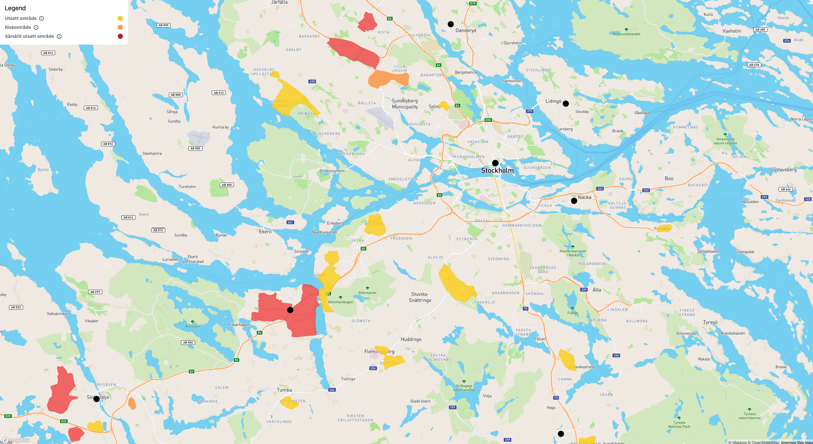

import CTAButton from "../../components/common/CTAButton.astro";

    <CTAButton label="View the project" url="https://mapper.nu" />

A fun small project I made during an afternoon after finding the geojson data available at [polisen.se](https://polisen.se/om-polisen/polisens-arbete/utsatta-omraden/), marking and ranking different areas of criminal activity in Sweden.
